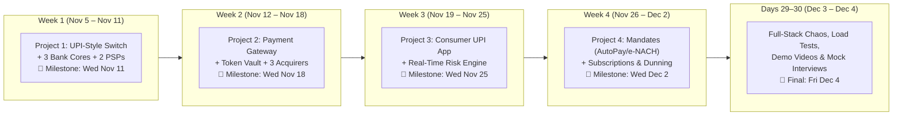

# 30-Day Payments & Fintech Infrastructure Mastery Roadmap

**Timeline:** Thursday, Nov 5, 2026 – Friday, Dec 4, 2026 (30 Days)  
**Target Outcome:** 4 Production-Grade Fintech Infrastructure Projects + Mastery of the 19 Payment Rules, 13 Core Fintech Domains, 8 Cross-Track Engineering Skills, and Product-Tier Interview Readiness (₹20–29L Tier: Juspay, Razorpay, PhonePe, NPCI).

> [!IMPORTANT]
> **Compressing 12 Weeks into 30 Days Without Cutting Depth**
> The original specification sizes each project at 3 weeks, but because all four projects share the **same 19 foundational rules** (integer paise, append-only double-entry ledger, idempotency middleware, HMAC service signing, immutable audit logs, chaos injection, and Prometheus observability), building a **shared core foundation on Days 1–2** lets you complete one complete project at the end of each 7-day sprint (Days 7, 14, 21, 28) plus 2 final days (Days 29–30) for cross-project E2E verification, load testing, and interview defense.

---

## Daily Structure (Recommended Calendar Blocks)

Every day in the 30-day schedule is structured into **four focused blocks** so you master both deep payment internals and the DSA/system-design loops required by Razorpay, Juspay, and PhonePe:

| Time Block (IST)  | Session Type                          | Focus                                                                                                                        |
| :---------------- | :------------------------------------ | :--------------------------------------------------------------------------------------------------------------------------- |
| **09:00 – 10:30** | **Deep Theory & Industry Study**      | NPCI/RBI circulars, ISO 8583/20022 specs, Stripe/Razorpay/Juspay architecture patterns, PCI-DSS & ledger math.               |
| **10:30 – 13:30** | **Core Backend & Infra Build**        | State machines, double-entry postings, concurrency locks, Kafka/Redis streams, idempotency, and chaos handling.              |
| **14:30 – 17:30** | **Simulators, Consoles & Automation** | Bank/Acquirer simulators, Admin/Merchant/Ops consoles, Playwright E2E + concurrent burst tests, Prometheus/Grafana.          |
| **18:00 – 19:30** | **DSA for Fintech Loops**             | Concurrency-safe data structures, graphs, sliding windows (velocity rules), trees, heaps (routing), and dynamic programming. |

---

## High-Level 30-Day Sprint Architecture

---

## Week 1 (Days 1–7): Project 1 — UPI-Style Switch + Bank Cores + Settlement & Reconciliation

**Dates:** Thu, Nov 5 – Wed, Nov 11, 2026  
**Cross-Track Skills Integrated (6/8):** Proper APIs (Idempotency/HMAC), Docker/CI-CD, Event Streaming (Redis Streams/Kafka for async credit retries & message logs), OAuth2/JWT + Audit Logs, API/Playwright Automation, Observability (Prometheus + structured hop tracing).

|  Day  | Date            | Deep Learning Topic (Morning)                                                                                                                                                                                                                                                  | Engineering Deliverable (Afternoon)                                                                                                                                                                                                                                             | Calendar Event Title                                                      |
| :---: | :-------------- | :----------------------------------------------------------------------------------------------------------------------------------------------------------------------------------------------------------------------------------------------------------------------------- | :------------------------------------------------------------------------------------------------------------------------------------------------------------------------------------------------------------------------------------------------------------------------------ | :------------------------------------------------------------------------ |
| **1** | **Thu, Nov 5**  | **Money Math, Double-Entry Ledgers & ISO 8583 / 20022** Study why floats fail, integer `paise`, append-only debit/credit postings summing to `0`, derived `available` balances (excluding holds), and Base24/NPCI ISO 8583 fields (`MTI`, `STAN`, `RRN`, `Response Codes`). | Scaffold monorepo/shared core: HMAC request signing (`<5m` replay protection), idempotency key middleware (`409` on payload mismatch), immutable audit log table, and ISO 8583 JSON envelope validator.                                                                         | `[Fintech D01] Double-Entry Ledger, Paise Math & ISO 8583 Core`           |
| **2** | **Fri, Nov 6**  | **NPCI UPI Architecture: PSP, TPAP, VPA & Bank Cores** Study how NPCI resolves `anita@psp1` via PSP directories, masked account discovery (`XXXX4521`), and atomic bank core transactions.                                                                                  | Build **3 Bank Core Simulators** (same code, distinct configs: `BANKA`, `BANKB`, `BANKC`) with accounts, hashed UPI PIN (3-strike freeze), limits, double-entry postings, and **2 PSP Simulators** (`PSP1`, `PSP2`) with VPA directory (`GET /vpa/{handle}`).                   | `[Fintech D02] Bank Core Simulators & PSP VPA Directory`                  |
| **3** | **Sat, Nov 7**  | **The 6-Hop Pay Flow & Exactly-Once Debit Concurrency** Study race conditions in concurrent requests, DB row locking / unique constraints on `RRN`, and state machine transitions (`RECEIVED → DEBIT_REQUESTED → DEBITED → CREDIT_REQUESTED → SUCCESS`).                    | Build the **Central Switch** happy-path `POST /pay` (MTI `0200`/`0210`) & balance enquiry (`0100`/`0110`). Write the 5-concurrent duplicate request burst test proving exactly one debit posting is created.                                                                    | `[Fintech D03] Switch 6-Hop Pay Flow & Exactly-Once RRN Debit`            |
| **4** | **Sun, Nov 8**  | **Distributed Failure Modes: Timeouts, Reversals & Deemed-Approved** Study the "Unknown Outcome" principle (Rule 7), status checks (`CHK`), credit-leg retry schedules, `0420` reversals, and deemed-approved conflicts.                                                    | Implement Switch timeout handling (default 5s $\rightarrow$ `CHK` status check), `DEBIT_SUCCESS_CREDIT_PENDING` async retries, auto-reversal (`0420`) on credit deadline expiry, deemed-approved conflict detection, and mid-transaction crash recovery on startup.             | `[Fintech D04] Timeouts, Status Checks, 0420 Reversals & Deemed-Approved` |
| **5** | **Mon, Nov 9**  | **Multilateral Net Settlement (T+1) & Cut-Off Windows** Study how clearing houses compute net payable/receivable positions across banks so bilateral transfers are minimized, and how clock skew is prevented.                                                              | Build the **T+1 Settlement Engine**: configurable cut-off window, net position calculator (sum across banks = 0), immutable versioned CSV generator (per-bank summary, RRN detail file, cycle manifest with header/trailer SHA-256 hash).                                       | `[Fintech D05] T+1 Net Settlement Engine & Immutable CSV Manifests`       |
| **6** | **Tue, Nov 10** | **Three-Way Reconciliation & Exception Resolution** Study Switch vs. Remitter vs. Beneficiary matching and every mismatch taxonomy (`MISSING_AT_REMITTER`, `MISSING_AT_BENEFICIARY`, `MISSING_AT_SWITCH`, `AMOUNT_MISMATCH`, `STATUS_MISMATCH`).                            | Build Bank EOD independent report generators, the **3-Way Reconciliation Engine**, and the **Switch Admin Console (Web)** with live 6-hop trace viewer, chaos injection controls, settlement runner, and exception resolution queue (trigger credit/reversal with audit trail). | `[Fintech D06] 3-Way Reconciliation Engine & Switch Admin Console`        |
| **7** | **Wed, Nov 11** | **🎯 MILESTONE 1: Project 1 Load Test, Chaos Verification & Demo** Review all 10 Acceptance Tests, Prometheus metrics, and interview talking points ("Why is exactly-once debit hard?").                                                                                    | Run 100 TPS end-to-end load test (`p95 < 1s`), execute all 10 acceptance tests (including kill/restart mid-flight), finalize Project 1 README + state diagrams, and record the 5-minute demo video.                                                                             | `🏆 [MILESTONE 1] Project 1 Delivery: UPI Switch, Bank Cores & Recon`     |

---

## Week 2 (Days 8–14): Project 2 — Gateway Orchestration, Token Vault & Merchant Dashboard

**Dates:** Thu, Nov 12 – Wed, Nov 18, 2026  
**Cross-Track Skills Integrated (7/8):** Proper APIs (Key rotation with overlap, idempotent orders/refunds, signed webhooks), Docker/CI-CD, Event Streaming (Webhook worker queue + rolling health score aggregator), OAuth2/JWT + RBAC, Playwright Checkout E2E, Prometheus Observability, LLM Feature (Acquirer failure normalizer & smart routing insights with schema validation).

|  Day   | Date            | Deep Learning Topic (Morning)                                                                                                                                                                                                                                                                                      | Engineering Deliverable (Afternoon)                                                                                                                                                                                                                                     | Calendar Event Title                                                 |
| :----: | :-------------- | :----------------------------------------------------------------------------------------------------------------------------------------------------------------------------------------------------------------------------------------------------------------------------------------------------------------- | :---------------------------------------------------------------------------------------------------------------------------------------------------------------------------------------------------------------------------------------------------------------------- | :------------------------------------------------------------------- |
| **8**  | **Thu, Nov 12** | **Payment Gateway Architecture (Razorpay/Stripe/Cashfree Model)** Study merchant onboarding lifecycles (`CREATED → UNDER_REVIEW → ACTIVE`), test vs. live modes, and zero-downtime HMAC API key rotation with overlap windows.                                                                                  | Build **Gateway API** merchant onboarding, MDR + GST fee plan configuration, HMAC authentication middleware, and API key rotation with configurable overlap window.                                                                                                     | `[Fintech D08] Gateway Onboarding, MDR Plans & Overlap Key Rotation` |
| **9**  | **Fri, Nov 13** | **Orders vs. Payment Attempts, Auto vs. Manual Capture & Checkout UX** Study why 1 Order $\rightarrow$ N Payment Attempts (`CREATED → ATTEMPTED → AUTHORIZED → CAPTURED → SETTLED`), auth-and-capture 7-day window, and duplicate payment auto-refunds.                                                         | Build `/orders` (10-concurrent idempotency test), manual `/capture` and `/void`, **3 Acquirer Simulators** (with 3DS OTP page + chaos controls), and mobile-first **Hosted Checkout** (`<2s` first paint, Card, UPI via Project 1 Switch, Net-banking, Wallet).         | `[Fintech D09] Orders, Multi-Attempt Lifecycle & Hosted Checkout`    |
| **10** | **Sat, Nov 14** | **Payment Orchestration & Dynamic Success-Rate Routing (Juspay Model)** Study BIN routing (first 6 digits), rolling health scores (success rate, p95 latency, timeouts), and technical failure (`5xx`/timeout $\rightarrow$ failover) vs. business decline (`51` insufficient funds $\rightarrow$ never retry). | Build the **Orchestration & Routing Engine**: per-minute rolling health score worker, automatic demotion/restoration, session-level single failover on technical errors, operator force/block overrides, and attempt-by-attempt routing reason logs.                    | `[Fintech D10] Smart Acquirer Routing, Health Scores & Failover`     |
| **11** | **Sun, Nov 15** | **PCI-DSS Scope Isolation & Card Tokenization Vaults** Study PCI-DSS boundaries, why merchants/gateways must never touch raw PANs, direct browser-to-vault tokenization, and encrypted-at-rest storage.                                                                                                         | Build the isolated **Token Vault Service** (separate deployable + separate DB, AES-GCM encryption with config key, `/tokenize`, internal-only `/detokenize`, saved cards per merchant customer) and pass the **100-payment Grep Test** (zero PANs in logs/gateway DB).  | `[Fintech D11] Isolated PCI Token Vault, Saved Cards & Grep Test`    |
| **12** | **Mon, Nov 16** | **At-Least-Once Signed Webhooks & Merchant Double-Entry Ledger** Study webhook delivery guarantees, exponential backoff (`1m, 5m, 30m, 2h, 6h, 24h`), consumer event-id deduplication, and MDR/GST/Reserve ledger accounting.                                                                                   | Build the separate **Webhook Delivery Worker** (HMAC signatures, delivery log, manual resend, 24h `FAILING` circuit breaker) and **Merchant Ledger** (`Receivable`, `Payable`, `Gateway Revenue`, `GST Tax`, `Rolling Reserves`) + partial/full idempotent **Refunds**. | `[Fintech D12] Signed Webhook Worker, Refunds & MDR/GST Ledger`      |
| **13** | **Tue, Nov 17** | **T+1/T+2 Merchant Payouts, Nightly Ledger Check & Dashboards** Study payout batching, reserve release schedules, and merchant vs. operator observability.                                                                                                                                                      | Build the **Payout Engine** (downloadable settlement reports), nightly dashboard-vs-ledger invariant check, **Merchant Dashboard**, Operator Routing Analytics page, and **Demo Merchant Store** (with signature-verifying webhook receiver).                           | `[Fintech D13] Merchant Payouts, Dashboard & Reference Demo Store`   |
| **14** | **Wed, Nov 18** | **🎯 MILESTONE 2: Project 2 E2E Verification, Integration Guide & Demo** Review all 10 Project 2 Acceptance Tests and interview talking points ("Technical vs. business decline", "How the vault enforces PCI isolation").                                                                                      | Run all 10 acceptance tests (Playwright checkout + 10-way concurrent order creation + grep test + key rotation), write the Merchant Developer Integration Guide, and record the Project 2 demo video.                                                                   | `🏆 [MILESTONE 2] Project 2 Delivery: Payment Gateway & Token Vault` |

---

## Week 3 (Days 15–21): Project 3 — UPI-Style Consumer App + Real-Time Risk Engine

**Dates:** Thu, Nov 19 – Wed, Nov 25, 2026  
**Cross-Track Skills Integrated (7/8):** Proper APIs (Device-signed requests, client txn ID dedupe), Docker/CI-CD, Event Streaming (Real-time velocity window counters & notification fan-out), OAuth2/JWT + Device Public Key Crypto, E2E Mobile/API Tests, Observability (`<100ms` p95 risk scoring metrics), LLM/RAG Feature (Natural-language-to-Risk-Rule JSON compiler with strict schema validation & shadow-mode verification + automated Dispute Case File summarizer).

|  Day   | Date            | Deep Learning Topic (Morning)                                                                                                                                                                                                                                            | Engineering Deliverable (Afternoon)                                                                                                                                                                                                                                                                       | Calendar Event Title                                                     |
| :----: | :-------------- | :----------------------------------------------------------------------------------------------------------------------------------------------------------------------------------------------------------------------------------------------------------------------- | :-------------------------------------------------------------------------------------------------------------------------------------------------------------------------------------------------------------------------------------------------------------------------------------------------------- | :----------------------------------------------------------------------- |
| **15** | **Thu, Nov 19** | **TPAP/PSP Security: Device Binding, Asymmetric Keys & PIN Nonces** Study how PhonePe/GPay bind an account to one physical SIM/device keypair, 24-hour new-device cooling limits, and per-transaction nonce PIN hashing.                                              | Build **PSP Backend** onboarding (`/signup`, `/devices/bind`, `/pin`), asymmetric device signature verification middleware, second-device takeover flow (retires old device + triggers 24h cap), 5-wrong-PIN 30m lock, and Bank Core account discovery/linking.                                           | `[Fintech D15] Device Binding, Asymmetric Signing & Account Discovery`   |
| **16** | **Fri, Nov 20** | **Four Pay Flows, QR Specification & "Honest Pending UX"** Study NPCI QR URI format (`upi://pay?pa=...&am=...`), directory name verification, and why mobile payment apps must _never_ fake success/failure on network drop.                                          | Build **Consumer Mobile App** + PSP endpoints for VPA creation (`mobile@psp` + custom handles) and all **4 Pay Paths** (QR scan/generate, VPA, Mobile lookup, Bank Account + IFSC). Build the **Honest Pending Screen** that survives airplane mode & app restart.                                        | `[Fintech D16] Mobile App 4 Pay Flows, QR Parser & Honest Pending UX`    |
| **17** | **Sat, Nov 21** | **Collect (Pull) Requests, Abuse Controls & Pre-Switch Limits** Study collect-request fraud patterns (scammers spamming collect requests), payer blocking, fan-out velocity detection, and multi-tiered PSP limits.                                                   | Implement **Collect Flows** (`/collects`, approve with PIN, decline, expiry auto-cancel), collect abuse controls (per-hour/per-payer rate limits, new-account fan-out flags, block requester), and pre-switch **Limit Profiles** (per-txn, daily count/amount, 24h new-device cap, new-counterparty cap). | `[Fintech D17] Collect Requests, Fan-Out Abuse Controls & PSP Limits`    |
| **18** | **Sun, Nov 22** | **Real-Time Fraud & Risk Engines (<100ms Latency Architecture)** Study data-driven rule engines, sliding-window velocity counters (10m / 24h), 30-day median anomaly detection, step-up authentication (OTP / 30m cooling delay), and fallback strategies on timeout. | Build the **Real-Time Risk Engine** (`/risk/score` returning in `<100ms` p95 with fallback on timeout) with all 7 starter rules (velocity, median anomaly, new counterparty, new device <24h, collect fan-out, blacklist, round-amount + night-time) and `ALLOW` / `STEP_UP` / `DECLINE` execution.       | `[Fintech D18] Real-Time Risk Engine (<100ms), Velocity Rules & Step-Up` |
| **19** | **Mon, Nov 23** | **Explainable Risk Decisions, Rule Versioning, Replay & Shadow Mode** Study how risk analysts deploy stricter fraud rules safely in production using **Shadow Mode** (dual evaluation without customer impact) and historical payment replay.                         | Build Risk Rule Versioning (`active`, `shadow`, `retired`), full decision explainability logs (fired rules, weights, input values), historical payment `/risk/replay`, and the **Shadow Mode Evaluator & Diff Report**. Add LLM Rule Compiler (with schema validation + mandatory shadow mode).           | `[Fintech D19] Risk Rule Versioning, Shadow Mode & Decision Replay`      |
| **20** | **Tue, Nov 24** | **Dispute Lifecycle & Cross-System Reconciliation Linking** Study NPCI dispute categories, SLA deadlines, and how consumer disputes link directly to switch reconciliation exceptions and pending reversals.                                                          | Build the **Dispute Desk** (`OPEN → UNDER_REVIEW → RESOLVED_CREDITED                                                                                                                                                                                                                                      | RESOLVED_REJECTED                                                        | ESCALATED`), auto-resolution listener when Project 1 switch reversals land, downloadable Escalated Case File generator, **In-App Inbox/Notifications**, and **Web Ops Console**. | `[Fintech D20] Dispute Desk Linked to Switch Recon & Ops Console` |
| **21** | **Wed, Nov 25** | **🎯 MILESTONE 3: Project 3 Load Test (50 TPS <100ms), Walkthrough & Demo** Review all 10 Project 3 Acceptance Tests, accessibility checks, and interview talking points ("How do you stop fraud without blocking good users?").                                      | Benchmark Risk Engine at 50 TPS (`p95 < 100ms`), execute all 10 acceptance tests (including airplane-mode restart & 100-payment shadow mode report), document starter ruleset rationale, and record the Project 3 demo video.                                                                             | `🏆 [MILESTONE 3] Project 3 Delivery: Consumer UPI App & Risk Engine`    |

---

## Week 4 (Days 22–28): Project 4 — Recurring Payments, Mandates & Subscriptions

**Dates:** Thu, Nov 26 – Wed, Dec 2, 2026  
**Cross-Track Skills Integrated (6/8):** Proper APIs (Idempotent execution keys, Project 2 webhooks), Docker/CI-CD, Event Streaming (High-throughput 10,000-cycle minute scheduler fan-out), OAuth2/JWT + Templated Audit Trail, API/E2E Time-Travel Tests, Observability (MRR/Churn & batch exception metrics).

|  Day   | Date            | Deep Learning Topic (Morning)                                                                                                                                                                                                                                                                                                           | Engineering Deliverable (Afternoon)                                                                                                                                                                                                                                                                                                              | Calendar Event Title                                                                                       |
| :----: | :-------------- | :-------------------------------------------------------------------------------------------------------------------------------------------------------------------------------------------------------------------------------------------------------------------------------------------------------------------------------------- | :----------------------------------------------------------------------------------------------------------------------------------------------------------------------------------------------------------------------------------------------------------------------------------------------------------------------------------------------- | :--------------------------------------------------------------------------------------------------------- |
| **22** | **Thu, Nov 26** | **RBI Recurring Mandate Regulations: AutoPay vs. e-NACH** Study UMRN (Unique Mandate Reference Number), amount caps, re-authorization rules, purpose codes, synchronous switch AutoPay vs. asynchronous bank e-NACH batch files.                                                                                                     | Build the **Mandates Service**: AutoPay mandate creation + approval inside Project 3 App (with PIN) + registration on Project 1 Switch; e-NACH async mandate registration against Bank Core; cap enforcement, re-authorization flow, and immediate customer pause/revoke propagation.                                                            | `[Fintech D22] AutoPay & e-NACH Mandates, UMRN & Cap Re-Authorization`                                     |
| **23** | **Fri, Nov 27** | **Subscription State Machines, Proration Math & Calendar Edge Cases** Study billing anchors (29th/30th/31st snapping in Feb + leap years), customer timezone vs. UTC storage, and mid-cycle upgrade/downgrade proration math to the exact paise.                                                                                     | Build the **Subscriptions Service** & **Injectable Fake Clock**: Plans (intervals, trials, setup fees, metered caps), Subscription state machine (`CREATED → AUTHENTICATED → ACTIVE → PAST_DUE                                                                                                                                                   | PAUSED                                                                                                     | HALTED                                                                                                                                                                                                                                                                     | CANCELLED`), mid-cycle proration calculator, and Feb 28/29/Mar 31 timezone-safe calendar engine. | `[Fintech D23] Subscriptions, Proration Math, Calendar Edge Cases & Fake Clock` |
| **24** | **Sat, Nov 28** | **Pre-Debit Regulatory Notices & Kill-Safe Exactly-Once Execution** Study RBI's mandatory 24-hour pre-debit notification rule, execution windows (06:00–22:00), and how to guarantee a crashed scheduler never double-debits a customer.                                                                                             | Build the **Scheduler & Executor**: mandatory 24h (2m demo) pre-debit notice gate (with 1-click cancel/pause link), unique `execution_key = subscription_id + cycle_number` claim lock, AutoPay switch execution within allowed window, and the **Executor Kill Test** (kill mid-flight $\rightarrow$ restart resolves via switch status check). | `[Fintech D24] Pre-Debit Notice Gate & Kill-Safe Exactly-Once Executor`                                    |
| **25** | **Sun, Nov 29** | **e-NACH Batch Presentment, Response Ingestion & Missing-Record Rules** Study fixed-width/CSV bank batch clearing, T+1/T+2 return codes (insufficient funds, account closed, mandate not found), and why missing response records must never be assumed successful.                                                                  | Build the **e-NACH Batch Engine & Bank Batch Simulator**: daily per-bank presentment file generator, `/nach/present` & `/nach/response/{batch}` simulator, response ingestion worker, missing-record exception detector, and integration with Project 2's Merchant Ledger.                                                                       | `[Fintech D25] e-NACH Batch Presentment, Bank Simulator & Exception Rules`                                 |
| **26** | **Mon, Nov 30** | **Intelligent Dunning, Soft vs. Hard Failures & Pay-Now Recovery** Study the distinction between soft declines (`51` insufficient funds $\rightarrow$ retry schedule day 1, 3, 7 with fresh reference) and hard declines (mandate revoked/account closed $\rightarrow$ immediate `HALTED`), grace periods, and out-of-band recovery. | Build the **Dunning Engine**: configurable per-merchant retry schedules, `PAST_DUE` grace period tracking, templated dunning notifications carrying a **Pay-Now Link** (charging via Project 2 Hosted Checkout to clear the cycle and restore `ACTIVE`), and aggregate cap queueing for simultaneous cycles.                                     | `[Fintech D26] Dunning Engine, Soft vs Hard Failures & Pay-Now Recovery`                                   |
| **27** | **Tue, Dec 1**  | **Invoicing, SaaS Revenue Analytics (MRR/Churn) & Portals** Study invoice lifecycles (`DRAFT → ISSUED → PAID                                                                                                                                                                                                                         | VOID                                                                                                                                                                                                                                                                                                                                             | UNCOLLECTIBLE`), MRR movement (New, Expansion, Contraction, Churn), and revenue-to-invoice reconciliation. | Build the **Invoice & Receipt Generator** (downloadable PDF/HTML documents), **Customer Portal** (in Project 3 app + web), **Merchant Subscription Dashboard** (extending Project 2 with MRR/churn/recovery charts + `subscription.*`, `mandate.*`, `invoice.*` webhooks). | `[Fintech D27] Printable Invoices, MRR/Churn Analytics & Customer Portal`                        |
| **28** | **Wed, Dec 2**  | **🎯 MILESTONE 4: 10,000-Cycle Load Test, Month-in-Minutes Run & Demo** Review all 10 Project 4 Acceptance Tests and interview talking points ("How do subscriptions handle failed debits?", "How do you prevent double billing across 10k concurrent cycles?").                                                                     | Benchmark **10,000 cycles due in the same minute** (zero duplicate execution keys), run the full "Month of Billing in Minutes" fake-clock acceptance script, verify MRR reconciles with paid invoices, and record the Project 4 demo video.                                                                                                      | `🏆 [MILESTONE 4] Project 4 Delivery: Mandates, Subscriptions & Dunning`                                   |

---

## Days 29–30: Full-Stack Unification, Portfolio Packaging & Interview Defense

**Dates:** Thu, Dec 3 – Fri, Dec 4, 2026

|  Day   | Date           | Focus Area                                                                                             | Concrete Deliverables                                                                                                                                                                                                                                                                                                                                                          | Calendar Event Title                                                        |
| :----: | :------------- | :----------------------------------------------------------------------------------------------------- | :----------------------------------------------------------------------------------------------------------------------------------------------------------------------------------------------------------------------------------------------------------------------------------------------------------------------------------------------------------------------------- | :-------------------------------------------------------------------------- |
| **29** | **Thu, Dec 3** | **Full-Stack Unified Orchestration & Cross-Project Chaos Testing**                                     | • Single root `docker compose up` (or script) that boots all 4 projects + simulators + seeded data. • Top-level portfolio repository with the master architecture diagram linking all 4 repos and demo videos. • Verify the 8 Cross-Track Skills checklist across every repo (CI badges, Prometheus/Grafana dashboards, Playwright suites, Event streams, LLM features). | `[Fintech D29] Unified 4-Project Stack Spin-Up & Cross-Track Audit`         |
| **30** | **Fri, Dec 4** | **🎯 FINAL MILESTONE: Product-Tier Fintech Interview Simulation (Juspay / Razorpay / PhonePe / NPCI)** | • Write the "Three Hardest Engineering Decisions & What We Rejected" design doc for each project. • Rehearse the 9 core interview talking points (Page 33–34) + live walkthrough of the kill tests, grep test, 3-way reconciliation, and shadow-mode risk engine. • Finalize resume bullets highlighting throughput/p95 benchmarks and daily AI tooling.                 | `🏆 [FINAL MILESTONE] Complete 4-Project Fintech Stack & Interview Defense` |
