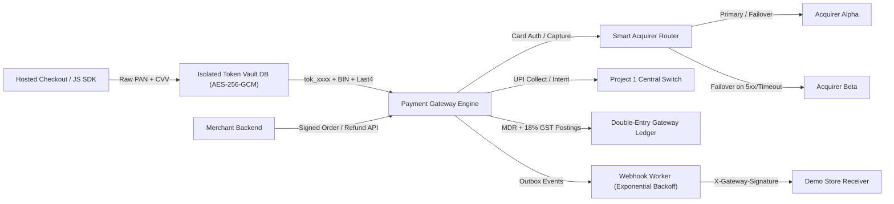

# Project 2 — Merchant Payment Gateway, Smart Routing & Webhook Engine (`@fintech/project2-gateway`)

Production-grade multi-rail Merchant Payment Gateway supporting **Card**, **UPI** (integrated with Project 1 `@fintech/project1-switch`), and **Netbanking**, complete with an isolated **PCI-DSS Token Vault**, **Dynamic Acquirer Smart Router** (success-rate + cost + latency + half-open circuit breaker), **Double-Entry MDR + 18% GST Settlement Ledger**, and **At-Least-Once Signed Webhook Worker**.

---

## 1. Architecture & PCI-DSS Isolation Boundary



- **Strict Vault Isolation ([`CardTokenVault`](src/token-vault.ts))**:
  - Uses its own isolated SQLite database (`vaultDb`) separate from `gatewayDb`.
  - Encrypts PANs at rest using **AES-256-GCM** (`iv`, `authTag`, `ciphertext`).
  - **CVV is NEVER stored** on disk even inside the vault.
  - Verified by `runPciGrepTest()` across 100 card transactions: zero raw PAN strings exist anywhere in `gatewayDb` tables, `vaultDb` columns, or structured JSON logs.

---

## 2. Smart Acquirer Routing & Circuit Breaker ([`SmartRoutingEngine`](src/routing-engine.ts))

- Evaluates eligible acquirers (`ACQ_ALPHA`, `ACQ_BETA`) per card network (`VISA`, `MASTERCARD`, `RUPAY`) and issuer BIN (`RoutingPrefixTrie`).
- **Composite Score**:
  $$\text{Score} = 0.60 \times \text{SuccessRate}_{20} + 0.25 \times \text{CostScore} + 0.15 \times \text{LatencyScore} + \text{BinBonus}$$
- **Circuit Breaker**:
  - Trips to `OPEN` for 30s when rolling 20-attempt success rate drops below `70%` or after `5` consecutive technical failures.
  - Transitions to `HALF_OPEN` after cooldown to allow `1` probe transaction.
- **Retry vs Non-Retry Discipline**:
  - **Technical Failures** (`TIMEOUT`, `5XX_SERVER_ERROR`, `NETWORK_ERROR`) automatically fail over to the second-ranked acquirer within the same checkout session.
  - **Business Declines** (`51_INSUFFICIENT_FUNDS`, `55_WRONG_OTP`, `54_EXPIRED_CARD`) are **never** retried on another acquirer.

---

## 3. Merchant Developer Integration Guide

### 3.1 Creating a Signed Order (`POST /v1/orders`)

Merchants sign API payloads using HMAC-SHA256 with their `api_secret` (supports zero-downtime key rotation with configurable overlap window):

```ts
import { signServiceMessage } from '@fintech/core';

const payload = {
  merchant_id: 'merch_acme01',
  amount_paise: 150000, // ₹1,500.00 in integer paise
  currency: 'INR',
  receipt: 'rcpt_order_001',
  capture_mode: 'AUTO',
  idempotency_key: 'idem_9f8a7b6c',
};

const { timestamp, signature } = signServiceMessage(payload, process.env.MERCHANT_API_SECRET!);
```

### 3.2 Verifying Incoming Webhooks (`X-Gateway-Signature`)

Every webhook request from `@fintech/project2-gateway` includes:
- `X-Gateway-Event-Id`: Unique event ID (`evt_...`) for idempotent deduplication on the merchant server.
- `X-Gateway-Timestamp`: Unix epoch milliseconds when the webhook was signed.
- `X-Gateway-Signature`: HMAC-SHA256 signature computed over `<timestamp>.<raw_json_body>`.

```ts
import { createHmac, timingSafeEqual } from 'node:crypto';

export function verifyGatewayWebhook(
  rawBody: string,
  timestampHeader: string,
  signatureHeader: string,
  webhookSecret: string,
): boolean {
  const ageMs = Math.abs(Date.now() - Number(timestampHeader));
  if (ageMs > 5 * 60 * 1000) return false; // 5-minute replay window

  const expected = createHmac('sha256', webhookSecret)
    .update(`${timestampHeader}.${rawBody}`)
    .digest('hex');

  return timingSafeEqual(Buffer.from(expected, 'hex'), Buffer.from(signatureHeader, 'hex'));
}
```

---

## 4. Running the Project 2 Acceptance & Benchmark Suite

```bash
npm run test:p2
```

---

## 5. Milestone 2 Interview Defense Talking Points

1. **Why does a gateway need dynamic routing instead of a single acquirer?**
   - Success rates fluctuate by issuer BIN, card network, ticket size, and time of day. `AcquirerRoutingEngine` scores each `(acquirer, method)` pair on a rolling 60s window (`successRate`, `p95 latency`, `timeouts`), demotes degraded pipes below threshold `60`, and fails over once within the session on technical errors (`91`/`68`/`96`) while **never** retrying business declines (`51`/`55`/`05`).
2. **How does the Token Vault enforce PCI-DSS isolation?**
   - Raw PANs go directly to `TokenVaultService` (`vaultDb` separate from `gatewayDb`), encrypted at rest with AES-256-GCM + random 12-byte IVs and config-only keys. CVV is never persisted. Detokenization requires both the internal `adapterCredential` and matching `merchant_id`, verified by the 100-payment `runPciGrepTest()`.
3. **How do you design webhooks a merchant can trust?**
   - Asynchronous outbox delivery signed with `HMAC-SHA256(secret, timestamp.rawBody)`, fresh timestamps on exponential backoff retries (`1m, 5m, 30m, 2h, 6h, 24h`), 24h `FAILING` circuit flagging + manual resend, and `event_id` deduplication at the receiver.
