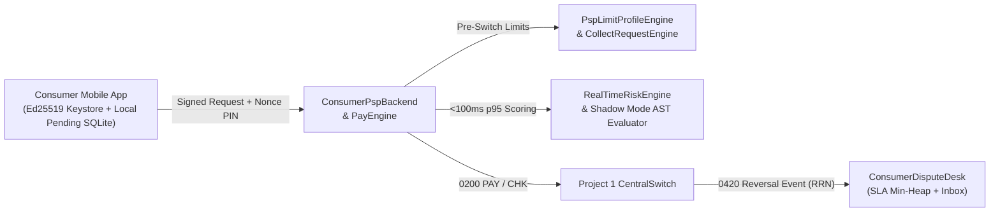

# Project 3 — Consumer UPI App, Device Security & Real-Time Risk Engine (`@fintech/project3-consumer-app`)

Production-grade TPAP/PSP consumer UPI stack featuring **Ed25519 asymmetric device binding**, **24-hour new-device cooling caps**, **salted per-transaction nonce PIN verification**, **4 consumer pay flows + NPCI QR parser**, **Honest Pending UX**, **Collect fan-out abuse controls**, a **`<100ms p95` Real-Time Risk Engine** with **Shadow Mode & AST rules**, and a **Dispute Desk** auto-resolved by Project 1 Switch reversals.

---

## 1. Architecture



---

## 2. Starter Risk Ruleset Rationale

| Rule ID | Weight | Rationale |
| :--- | :---: | :--- |
| `VELOCITY_10M` | +35 | Rapid burst ($\ge 4$ txns in 10m) indicates automated scripting or account takeover |
| `VELOCITY_24H` | +30 | High 24h cumulative outflow ($\ge \text{₹}50,000$) increases blast radius |
| `MEDIAN_ANOMALY_30D` | +35 | Amount $> 5\times$ customer's 30-day Two-Heaps running median flags out-of-pattern spend |
| `NEW_COUNTERPARTY_HIGH_AMOUNT` | +25 | First-time transfer $\ge \text{₹}2,000$ to an unknown VPA is the #1 social-engineering vector |
| `NEW_DEVICE_24H` | +25 | SIM-swap / phishing takeovers occur almost exclusively on newly bound devices |
| `COLLECT_FANOUT` | +45 | Targeting $\ge 10$ distinct payers in 1h identifies collect-request scam rings |
| `BLACKLIST_HIT` | +100 | Known mule VPAs / compromised devices trigger immediate `DECLINE` |
| `ROUND_AMOUNT_NIGHT_TIME` | +20 | Exact ₹1,000+ round transfers between `00:00–05:00 IST` correlate strongly with coercion scams |

- **Thresholds**: `< 40` -> `ALLOW`, `40–79` -> `STEP_UP` (`MOBILE_OTP` or `COOLING_DELAY_30M`), `>= 80` -> `DECLINE`.
- **Timeout Fallback**: Exceeding the `100ms` budget deterministically returns `ALLOW` (`<= ₹2,000`) and `STEP_UP` (`> ₹2,000`).

---

## 3. Running the Project 3 Suite

```bash
npm run test:p3
```

---

## 4. Milestone 3 Interview Defense Talking Points

1. **How do you stop fraud without blocking good customers?**
   - Layered friction: `ALLOW` / `STEP_UP` (OTP or 30m cooling delay) / `DECLINE`, backed by **Shadow Mode** dual evaluation so every stricter candidate ruleset produces a 100-payment Diff Report (`ALLOW->STEP_UP`, `agreementRatePercent`) before promotion to `ACTIVE`.
2. **Why is "Honest Pending UX" mandatory in mobile payments?**
   - Persisting `PENDING` locally with a client-generated `client_txn_id` *before* sending the HTTP request ensures that airplane mode or app force-close never fakes a failure (preventing double payments) and always reconciles cleanly on reopen.
3. **How do you track regulatory SLA breaches across 100,000+ open disputes?**
   - `SlaDeadlineMinHeap` peeks the soonest-to-breach dispute in $O(1)$ and extracts overdue disputes in $O(k \log N)$ using lazy deletion when Switch `0420` reversals auto-resolve disputes early.
