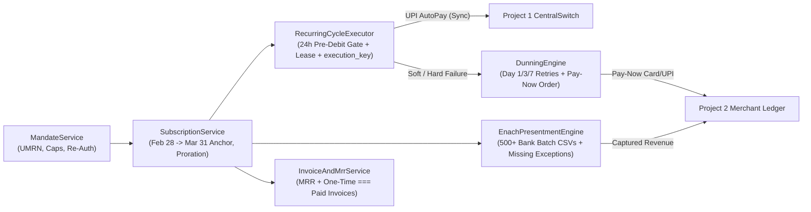

# Project 4 — Recurring Payments, RBI Mandates & Subscriptions (`@fintech/project4-mandates`)

Production-grade recurring payments & subscription billing engine supporting **UPI AutoPay** (synchronous via Project 1 Switch) and **e-NACH** (asynchronous daily bank batch files), **RBI 24-hour pre-debit notices**, **anchor-day calendar math**, **kill-safe exactly-once cycle execution**, **Day 1/3/7 dunning with Project 2 Pay-Now recovery**, and **MRR-to-Paid-Invoice reconciliation**.

---

## 1. Architecture



---

## 2. Running the Project 4 Suite & 10,000-Cycle Benchmark

```bash
npm run test:p4
```

---

## 3. Milestone 4 Interview Defense Talking Points

1. **"How does your scheduler process 10,000 due cycles in one minute without double-debiting?"**
   - Every cycle is identified by a deterministic `execution_key = subscription_id:cycle:N` enforced by a database `PRIMARY KEY` and a `DistributedLeaseManager` with monotonic fencing tokens. Competing workers are rejected in $O(1)$, and `execution_key` is forwarded as Project 1 Switch's `transaction_id` so even a `SIGKILL` mid-flight recovers via Switch status check with **strictly 1 bank debit**.
2. **"How do subscriptions handle a failed debit?"**
   - `DunningEngine` separates **Hard Failures** (`78_ACCOUNT_CLOSED`, `14_MANDATE_NOT_FOUND`, `MANDATE_REVOKED` -> immediate `HALTED`, 0 retries) from **Soft Failures** (`51_INSUFFICIENT_FUNDS`, `68_TIMEOUT` -> `PAST_DUE` + fresh Day 1, 3, 7 retry keys + a Project 2 Gateway **Pay-Now Recovery Link** that cancels all pending retries and restores `ACTIVE` upon payment).
3. **"How do you prevent anchor-day drift across February and leap years?"**
   - Store `anchor_day` (`1..31`) separately from `(current_year, current_month)` and compute `min(anchor_day, daysInMonth(year, month))` in the customer's timezone, so Jan 31 snaps to Feb 28 (or Feb 29 in leap years) and returns to Mar 31.
